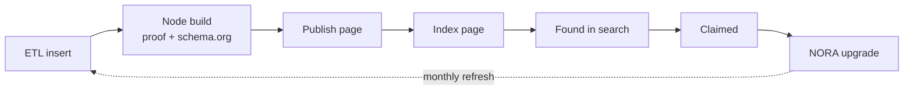
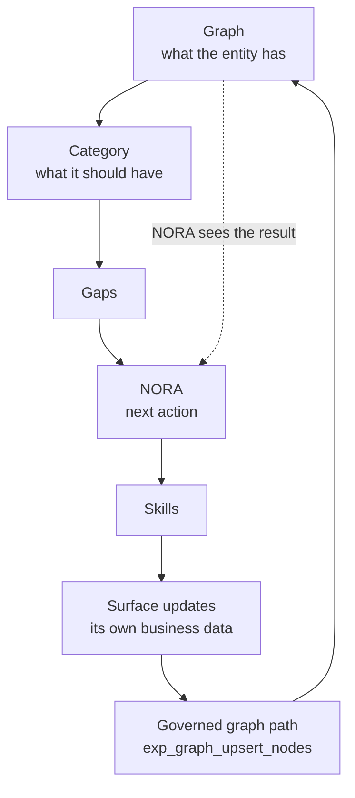
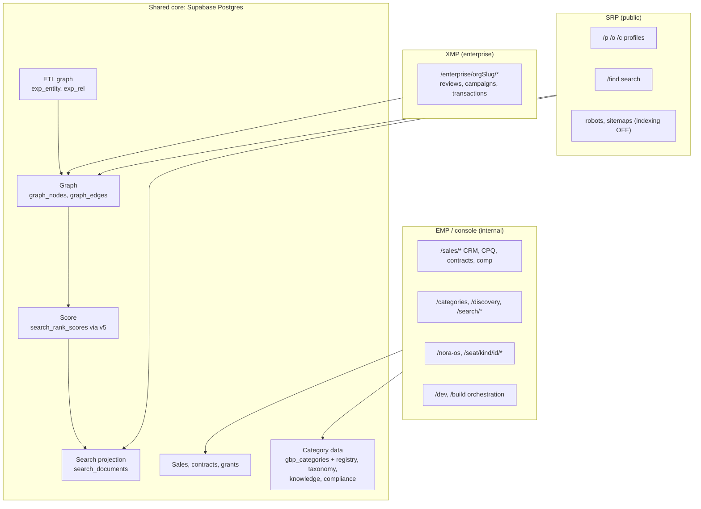
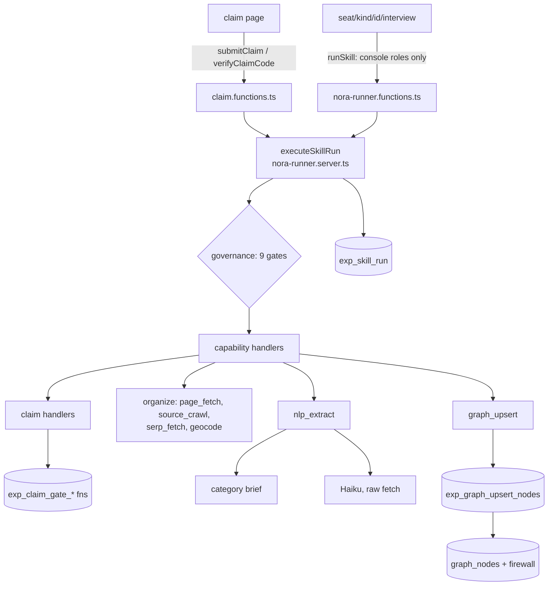
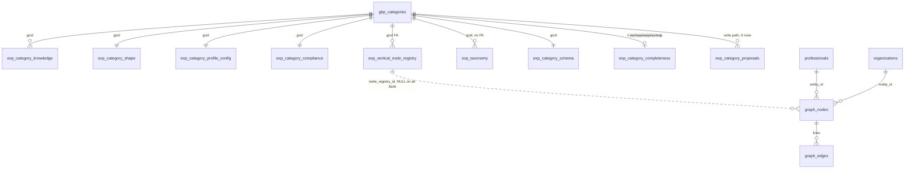
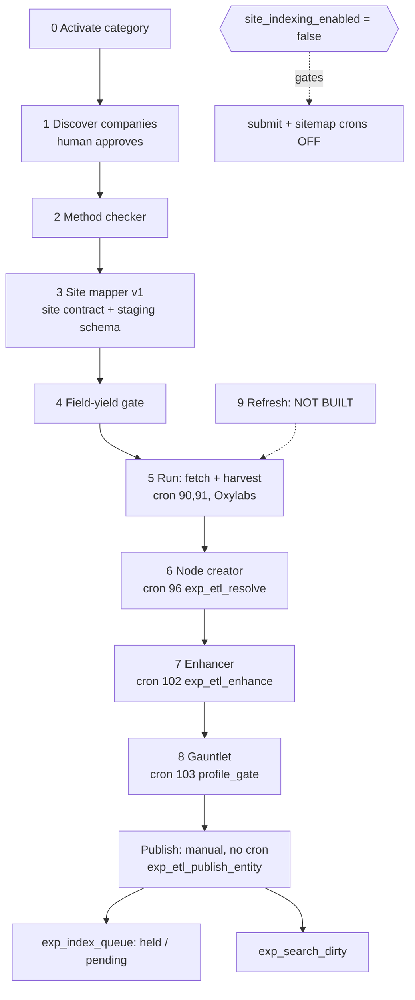
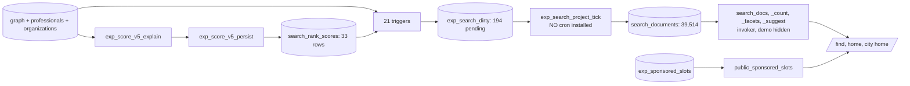
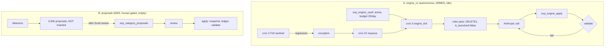
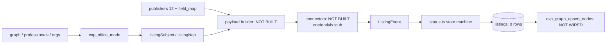
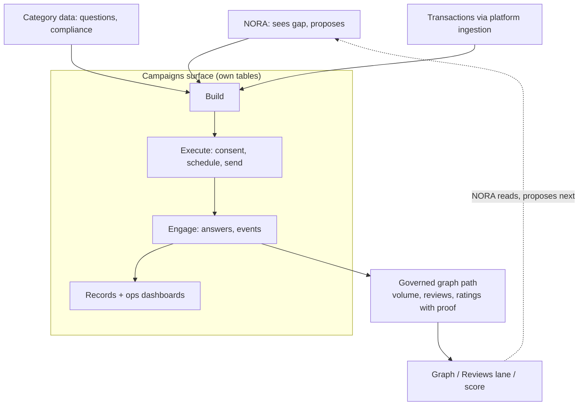

# Experience.com SRP: Platform Handoff (state as of 2026-10-12)

Audience: every developer joining the build. Read this before writing code.
Method: seven read-only audits of the repo (`main` @ 686be1c) and the live database, run on 2026-10-12.
Anything we could not confirm is marked **UNVERIFIED**. Counts are live counts on that date and will drift.

> **Precedence when documents disagree:** live database > `CLAUDE.md` > `docs/NORA_OS_ENGINEERING_DIRECTIVE.md` > `docs/NORA_OS_MASTER_BUILD_THREAD.md` > everything else.
> `STATUS.md`, `README.md`, `roadmap.md` and several older specs are **stale** (section 9). Do not build from them.

---

## 0. Read this first: the six non-negotiables

1. **One connected system.** ETL, nodes, publish, index, refresh, claim, NORA, and the sales stack (CRM, CPQ, contracts, commissions, boarding, entitlements) are one platform. No side systems, no external CRM, dialer, CPQ, e-sign or ETL.
2. **Build on the existing data model. Do not change the core data model.** Category data (knowledge model, node registry, taxonomy, rings, scoring targets, compliance) is changed only by Scott, Abdul or Claude, and only through the proposal path (section 5.5).
3. **Extend, never duplicate.** Before adding a table, function, route, dashboard or role system, find the existing one. Much of the logic lives in the live database. Check `pg_proc` and `pg_class`, not just the repo.
4. **Say "category", never "vertical".** The platform mirrors Google's 4,041 Business Profile categories exactly. A new category is configuration, not code. No per-category code paths.
5. **The graph is written only through the governed path.** No surface writes `graph_nodes` directly (section 2.2).
6. **Nothing goes live without Scott.** Site indexing is OFF and stays OFF until he flips it. No Google or IndexNow submissions. No design or restyling work until the final reskin.

---

## 1. What we are building

Experience.com SRP is an AI Search Rank Platform for local professionals and businesses, built **category-out**: organised around 4,041 GBP categories. Each entity gets a **10-ring expertise graph** that emits schema.org and powers the **850-point, 10-lane Search Rank Score (SRS v5)**.

Surfaces: **SRP** (public site and search), **XMP** (enterprise), **EMP** (internal console), **NORA OS** (the agent layer that finds gaps and acts).

### 1.1 The go-to-market chain

Pricing is not a focus right now and lives in the sales surfaces. Do not hard-code prices.

### 1.2 The six workstreams

| # | Workstream | One-line state |
|---|---|---|
| 1 | NORA OS | Skill runner, claim gate and interview UI are built. The interview cannot save live for a real owner yet (5.1). |
| 2 | Search and Sponsored Search | Live projection of 39,514 documents. Public ranking is not yet differentiated. Sponsored is demo-only (5.4). |
| 3 | Indexing / Data Integration | ETL stations 0 to 8 run. Publish works for a 91-profile pilot. Indexing is OFF (5.3). |
| 4 | Model Enrichment | Not yet defined by the owner. An old AI engine is still armed (5.5). |
| 5 | Listings Management | Catalog in the DB. No connector wired. 0 listings (5.6). |
| 6 | Conversion Agents | Built last. Data and pricing hooks exist, runtime does not (5.7). |

Campaigns / surveys (Medallia-style) is a seventh area being designed now (5.8).

---

## 2. Architecture

### 2.1 The core loop (this is the architecture; everything else hangs off it)

### 2.2 The rule behind the loop

- **Surfaces keep their own business records** (listings, campaigns, leads, quotes). They never write graph tables.
- **Only expertise-relevant outcomes reach the graph**, and only through `exp_graph_upsert_nodes` with provenance and a trust tier.
- `trg_graph_nodes_owner_firewall` silently skips writes that would overwrite owner-verified facts. **A direct write can look like it succeeded when it did not.** Always use the governed function.

### 2.3 Platform map

### 2.4 Two entity models (the most common source of confusion)

| | Model A: the product | Model B: the ETL/resolution graph |
|---|---|---|
| Tables | `professionals` (19,392), `organizations` (20,283), `graph_nodes` (554k), `graph_edges` (123) | `exp_entity` (95,574), `exp_rel` (241,875) |
| Read by | Public pages, scoring, search projection | ETL stations 6 to 8, publish |
| Link | `exp_entity.identity_keys.professional_id` / `organization_id` (JSON key, no FK) via `exp_entity_link_record` and `exp_entity_for_record` | |

Never invent another link table. Record ids are **not** entity ids: owner grants are scoped to the `exp_entity` id, so resolve through `exp_entity_for_record`.
Known gaps: only 70 organizations are linked; 557 professionals map to 2+ entities; State Farm agents are `insurance_agency` in Model A but `insurance_agent` in Model B.

### 2.5 The 10 rings

Canonical rings live in `exp_rings` (10 rows): identity, presence, location, authority, services, content, reputation, engagement, conversion, entity_graph.
**Ring vocabulary is currently inconsistent in the live system** (open decision O1):
- `exp_rings` has 10 keys.
- The node registry and `exp_validate_category_full` use **13** keys (adds media, social, transactions).
- `exp_ring` (a separate table, 23 rows) numbers rings differently and is what `exp_graph_upsert_nodes` reads, so NORA-written nodes carry a legacy ring integer.
- Two mappings from legacy to canonical disagree (`exp_ring_crosswalk` vs `LEGACY_RING_ALIAS` in `category-brief.ts`).

Until Scott rules, do not write new ring logic without asking which vocabulary applies.

### 2.6 Search Rank Score v5 (850 points, 10 lanes)

Reviews 187, Completeness 182, Website 102, Articles 103, GBP 68, Directories 90, Q&A 34, Connections 51, Videos 27, Audio 6.
Live scorer: `exp_score_v5_explain` (read) and `exp_score_v5_persist` (write, guarded). **`exp_compute_score_v2`, named in older docs, is legacy and nothing calls it.** Never score on numeric `ring` or `score_counted`.
Single-pro offices are scored as the professional, with GBP and Directories reading the location (`exp_office_mode`).

---

## 3. The rulebook

Source in brackets. Precedence: `CLAUDE.md` first.

**Data model and categories**
1. Organise around the 4,041 GBP categories, mirrored exactly. [`CLAUDE.md`]
2. Every seed keys off a real gcid. No invented categories (`realtor`, `family_dentist`, etc. were hallucinated and removed). Map to the nearest real one or do not seed. The gate is the `gbp_categories` table and `reference/gcid_universe.json`. (`gbp_categories_master.csv`, named in `CLAUDE.md`, is **not in the repo**.) [`CLAUDE.md`]
3. Gcids are stored exactly as `'gcid:xxx'`, everywhere, always. Never strip, add or re-namespace the prefix. [`CLAUDE.md` Identifier contract]
4. Before loading anything keyed by an existing identifier: read the canonical key format from a migration, diff the full key universe, reconcile gaps first. **Verify with a JOIN match-count, never an isolated row count.** [`CLAUDE.md`]
5. One fact, one canonical home. Vocabulary in `exp_taxonomy`; nodes in the registry; compliance in `exp_category_compliance`; conversion actions in `exp_category_knowledge.conversion_actions`; classification in `exp_category_schema_type`. The UI renders the canon only. [`DATA_MODEL_CANON.md`]
6. A profile has 1 primary and up to 9 secondary categories; registries are unioned and deduped by slug; the primary wins a collision; undeclared nodes stay dormant. [`COMPOSITION_CONTRACT.md`]
7. Active universe is 4,032 categories: 4 adult gcids and 9 untyped gcids are excluded. [`Listings_Scope_Decisions.md`]
8. Directories never determine category identity. [`STATUS.md` safeguard]
9. Protect the data set: never DROP, TRUNCATE or destructively ALTER `exp_*`, `graph_*`, `search_*`, `claim*` or `*_scores` tables. Snapshot before any load. [Master Build Thread s4]
10. Every fact carries provenance and a trust tier (`self_declared < imported < platform_observed < authority_verified < owner_verified`). [Master Build Thread s4]

**Changing category data**
11. Only Scott, Abdul or Claude change category data. [`CLAUDE.md`]
12. The path is: proposals, human sample review, snapshot, apply, ledger. Additive only; retire means `is_active=false`, never DELETE. Enforced by `exp_category_proposals` (0025). [`ETL-Enhancements.md` 2026-10-11]
13. Every semantic batch gets a 10 to 20 row diverse human review before it is scaled. [`STATUS.md`]

**One connected system**
14. No external CRM, dialer, CPQ, e-sign, sequencing, commissions or hand-off tools; no ETL outside the platform. [`CLAUDE.md`]
15. Roles exist already: `exp_control_grants` and `exp_crm_actor`. Never create another role system. [`CLAUDE.md`]
16. `/sales/opportunities/$oppId` is the only opportunity workspace; stage changes go through `exp_opp_*` functions. [`AGENTS.md`]
17. The CPQ catalog is built at runtime from `exp_products`, `exp_price_book`, `exp_pricing_config`. Code holds formulas only. `exp_price_tiers` is deprecated. [`AGENTS.md`]
18. No Supabase edge functions. Backend is `createServerFn`, `src/routes/api/*`, or pg_cron/pg_net. [Directive s3]

**Build order and boundaries**
19. Category, entity-type, registry (10 rings), knowledge model, taxonomy, compliance, scoring, AI config, schema output, claim/onboard, public pages, search, connectors, **then** listings, reviews, content, VOCE. [`CLAUDE.md`]
20. Listings stays FROZEN: `dashboard.listings.tsx` must not be wired to connectors. (The freeze condition, complete registries, is arguably met, but nobody has formally lifted it. Ask Scott.) [`CLAUDE.md`]
21. No restyling or design-system work until the final reskin. [`CLAUDE.md`]
22. Single-pro offices: act as the professional, list as the location. The decision lives only in `exp_office_mode`. Never re-decide it in TypeScript. [0027 header]

**Compliance**
23. Real estate: Fair Housing (no steering by protected class, brokerage name in ads, no sale or price guarantees). Mortgage: RESPA/TILA (no rate guarantees, display NMLS ID). [`CLAUDE.md`]
24. All AI-generated content, review replies and agent output must pass `content_compliance_rules` plus `exp_category_compliance` before publish. [`CLAUDE.md`]
25. Yelp review solicitation is a hard block. [`Listings_Scope_Decisions.md` item 8] (**Not enforced today: see 5.8.**)
26. Permissions and policy are enforced in deterministic code, never by the LLM. [Directive s5]

**Documentation, git and migrations**
27. Every DB function, table, trigger or cron change, and every ETL code change, gets an **append-only** entry in `docs/ETL-Enhancements.md` in the same session. Entry states: trigger, evidence, change, verification, still open. A fixed gap is named by its ID. A `-- Fix (...)` comment is not documentation. [`CLAUDE.md`]
28. Keep `main` working (Lovable syncs from it). Never force-push, rebase or squash pushed history. Edits must be verifiable from static reading. [`CLAUDE.md`]
29. One increment per branch, one PR, a human merges. [Master Build Thread s3]
30. Schema changes need a migration in `drizzle/migrations/NNNN_*.sql` plus a `meta/_journal.json` entry. `supabase/migrations/` is historical. [Master Build Thread s3, s6]
31. **Lovable does not apply merged migrations.** After approval, migrations are applied by hand through the DB connector (backup first, JOIN verification, then a doc entry). `drizzle.__drizzle_migrations` stops at 0016. [`ETL-Enhancements.md` 2026-10-11]
32. New tables ship with RLS on. Server writes use the service role. [Master Build Thread s4]

---

## 4. Status board

| Area | Built | In progress | Left |
|---|---|---|---|
| Category data | All 4,041 gcids covered across registry (952,559 rows), taxonomy (1.1M), knowledge, shape, compliance, schema type. 4,040 pass `exp_validate_category_full` | 0019 cardinality merged, not applied. `identity_keys` empty for all | Ring ruling; bare category-name keyword; 9 categories missing expected volumes; link instances to registry |
| NORA core | Runner, governance gates, claim gate (0021), category brief, extractor, governed upsert, interview UI | Interview cannot save live | Owner entry point; 4 organize skills published; 2 missing tools; stale adapters |
| ETL / publish | Stations 0 to 8 running; generic publisher; Schwab pilot (91 published) | Compass harvest; Schwab rework | Station 7 review screen; publish cron; Station 9 refresh |
| Indexing | Floor, queue, sitemap/robots, site-wide switch (0024) | Switch OFF by order | Pre-launch checklist (5.3) |
| Search and score | Projection (0023); v5 scorer (0027); anon-safe search RPCs | v5 persisted for a 20-entity sample | Score everyone; install projection cron; one score scale |
| Sponsored | Slots, pricing, ad units, page-view rollup (demo data) | | Real sales through CPQ; entity-linked slots |
| Enrichment | Old engine (armed, idle); proposal path (0025, empty) | 3,506 proposals generated, not inserted | Owner defines "enrichment" |
| Listings | 12-publisher catalog (0026); state machine; single-pro subject | | Rulings; payload builder; connectors; credentials |
| Conversion agents | Per-category conversion actions; CPQ product; empty lead tables | | Spec; runtime; lead store |
| Campaigns | Campaign table and wizard UI; outbox and cron; reviews; compliance for replies | | Everything that sends (5.8) |
| Sales / CRM / CPQ | 34 `sales.*` routes, stage engine, contracts, comp | CPQ margin, seller board | Payments; boarding (UNVERIFIED) |
| XMP | 14 enterprise routes | Depth UNVERIFIED | |
| Orchestration | `/dev`, `/build` | Statuses lag reality | Reconcile board |

---

## 5. Surface deep dives

### 5.1 NORA OS core

**Purpose.** For one entity, compare the graph with what its category expects (the *category brief*), find gaps, run governed skills. First slice: add profile, claim (T0/T1/T2 trust tiers), interview step 1 (claim), interview step 2 "organize the internet" (sweep, hop, category-aware extract, owner confirms, governed graph write). Works for all 4,041 categories with no per-category code: a restaurant collection is "many", a loan officer's products "few".

**Built (verified).** 37 skills and 44 capabilities in the registry. 6 skills published (claim_initiate, claim_silent_precheck, claim_challenge, claim_verify_email, claim_grant, claim_release). 15 capability handlers implemented. Claim Gate DB functions live (0021). 117 related tests pass. `exp_entity` linked to records (19,817 professionals).

**Not yet true (do not assume otherwise).**
- No claim has ever gone through the new gate. The 260 existing claims are backfilled. There are 0 owner grants.
- `exp_skill_run` has 1 row ever (a dry run on a synthetic entity).
- The OTP email cannot send (no SendGrid key). The Place ID path and geocoding are stubbed because both integration adapters are hard-wired to "not configured", although `src/lib/integrations.server.ts` is on `main`.
- All three integrations (`google_business_profile`, `google_places`, `apify`) are `mode='stub'`.

**Interview live-save blockers (in dependency order).**
1. **Owner path missing.** `runSkill` rejects non-console roles, so the claimant is refused. Build an owner-scoped entry point: authorise via an `owner` grant scoped to the `exp_entity` id; enforce the claim tier in code (organize and confirm need T1).
2. The four organize skills are `draft`; publish through `nora-registry.ts` after evals.
3. `dedupe_match` and `html_parse` have no handler. Reuse the ETL parser (`-disco-site-contract.ts`); do not write a new matcher.
4. Oxylabs credentials and `ANTHROPIC_API_KEY` presence in production: **UNVERIFIED**. The Haiku model id and parameters have never been called live: **UNVERIFIED**.
5. Organization interviews fail an entity-type check (`organization` vs `location`).
6. Single-pro offices are not handled in the interview or extractor.
7. Graph write authorisation checks `professionals.user_id`, not claim tier, so a claimed location cannot write its graph.

**Left to build (order).** Owner entry point; entity-type vocabulary fix; the two tools; point adapters at `integrations.server.ts`, set keys, flip modes; verify Haiku end to end with `exp_skill_eval` fixtures; publish skills; apply 0019 via proposals; one real end-to-end claim and interview as the acceptance test; interview steps 3 to 6 (need world-model tables that do not exist); `nora_chat` copilot; compliance filter inside the runner; async queue for metered capabilities.

**Pitfalls.** Testing as an admin and calling it done. Using record ids as entity ids. Writing `graph_nodes` directly. Faking a capability output or publishing a skill to bypass a gate (the honesty model, `not_implemented`, is the safety system). Per-category branches. Using `exp_ring` for new logic.

### 5.2 Data foundation and category system

**Purpose.** The category-out spine every surface reads. Category rows define what an entity should have; instances live in `graph_nodes`.

**Built (live).** `gbp_categories` 4,041 (3,637 location, 404 "both"; launched: `real_estate_agents`, `financial_advisor`). Registry 952,559 rows (935,223 active), every gcid covered. Taxonomy 1,097,116 rows across 13 levels. Knowledge 4,445 rows. Shape 4,041 (3,637 location_first, 404 professional_first). Compliance 4,041. 14 content rules. Validator `exp_validate_category_full`: 4,040 of 4,041 pass; `gcid:insurance_agent` fails `REG_NO_NAME_DUPES`. Curation ledger 275,803 rows.

**"Complete" means "passes the validator", not "fully populated".** The validator does not check: bare category-name keyword, `identity_keys`, node cardinality, or expected-volume rows.

**Known gaps.**
- `exp_category_shape.identity_keys` is `{}` for all 4,041.
- 0019 (cardinality) merged, not applied; the brief uses derived cardinality.
- 9 categories lack expected-volume and completeness rows (environment_renewable_natural_resources, mercantile_development, oxygen_cocktail_spot, staple_food_package, travel_lounge, closed_circuit_television, steel_fabricator, statuary, superfund_site).
- `graph_nodes.node_registry_id` is NULL everywhere, so instances join to expectations only by heuristics.
- **Bare category-name keyword is usually missing.** 3,890 of 4,041 categories lack their own name as an exact active keyword (e.g. "ceiling supplier" appears only as "ceiling supplier near me"). It exists as `profession_title` in most. Junk generated terms (e.g. "ceiling supplier gbp storefront address verified") also remain. Fix through proposals plus a validator check, not code.
- `exp_taxonomy.gcid` has no FK.
- `schema_cache` is empty; its trigger is on `graph_nodes` only, not `graph_edges`. Public pages use `src/lib/profile-render.ts` (`buildJsonLd`); `profile-graph.ts` (named in `CLAUDE.md`) is used only by one authenticated route.
- `src/lib/expertise-schema.ts` hard-codes two categories and strips the `gcid:` prefix. Both violate the rules above. Do not extend it.
- 5 orphan `exp_category_schema_type` rows (adult and accounting gcids not in the master).

### 5.3 Indexing and data integration (ETL, publish, index)

**Purpose.** Find the real companies in a category, learn each site once, harvest detail pages into staging, build governed entities, enrich and reconcile, gate each profile, publish, queue for indexing. Abdul runs the stations.

**Built (verified live).**
- **Indexing is OFF.** `exp_index_config.site_indexing_enabled='false'`; `exp_index_enabled()` returns false; crons 77 and 78 inactive; 39,605 queue rows, none submitted; the submission log has 6 old demo rows only. App side fails closed: `robots.txt` is `Disallow: /`, sitemaps empty, root noindex meta, `X-Robots-Tag` header. (Deployed headers were not fetched during the audit: UNVERIFIED.)
- Staging: 62,522 created rows across edwardjones.com (19,462), morganstanley.com (6,428), schwab.com (2,780), compass.com (17,450), statefarm.com (19,376).
- Published through the new publisher: **91 Schwab financial advisors** (pilot). State Farm's 19,221 profiles came through the older `exp_sf_apply` path.
- Required-fields rows exist for `gcid:financial_advisor` and `gcid:real_estate_agents`; both are launched.
- Station 7 output: 21,175 proposed promotions and 505 candidates (no review screen yet).
- Fetching uses Oxylabs through `/api/public/disco-webscraper-worker`; worker routes require the `x-disco-worker-key` header.

**How ETL database changes are made (read carefully).** Abdul and Claude sessions change `exp_etl_*` functions live with `CREATE OR REPLACE`. **No migration file is written.** The previous definition is saved to `exp_curation_ledger` (`action='definition_before_change'`) and the story goes in `docs/ETL-Enhancements.md`. So the **current definition exists only in the live database** (`pg_get_functiondef`). Do not assume a migration is the source of truth, and never add a parallel migration that overwrites a live function. Open item O9: bring these definitions into the repo.
Procedure: save the old definition to the ledger, test in a rolled-back transaction, get named approval from Scott, apply, append the doc entry.

**In progress.** Compass harvest (18,408 pages queued). Schwab rework (backfill written, re-harvest running, republish needed). Edward Jones office hours need cleaning before publishing. Site mapper v2 parked.

**Left to build (order).** Station 7 review screen; gate/launch/publish console; publish cron with retry; offices from person-level addresses and location-first publishing; drain the search projection and score everyone; Station 9 refresh scheduler (off by default, human-armed); enforce `robots_tos` and `pull_window` in fetching; remaining acquisition lanes.

**Before indexing is ever switched on:** per-page `index, follow` metas on marketing pages; fix the console route that lacks a robots prefix; IndexNow and Google credentials (Google's Indexing API only supports JobPosting/BroadcastEvent, so keep it OFF); one score scale. **Only Scott flips the switch.** Running `exp_index_sync` is safe (queue state only).

**Deploy caveat.** Merging to `main` does not update the public site: Lovable syncs `main` into the editor, but the published site only changes when someone publishes. On 2026-10-12 the published site was older than `main` (the new `robots.txt`, noindex header and interview page were not live). After any merge that matters to the public site, publish from Lovable and verify on the live URL (for example, `/robots.txt` must return `Disallow: /` while indexing is OFF).

**Pitfalls.** Looking for ETL logic in migrations. Turning on a cron. Writing a site-specific route (Scott rejected a Schwab-only route; fixes go into the generic site contract, generic taxonomy routes, or category data). Making the source domain the brand. Bulk runs without a dry run and a named approval. `exp_engine_rules_pass` resets `is_launched`: after a category rebuild, re-run `exp_etl_launch_category` or publishing silently pauses. The live gate key is `_gate.passed`.

### 5.4 Search, sponsored search and score

**Built.** Projection (0023) applied: 39,514 documents (19,301 professionals, 20,207 locations, 6 brands; 106 demo hidden). v5 scorer (0027) live; v5 persisted for a 20-entity sample (33 rows, including mirrored single-pro offices). Sponsored plumbing: `public_sponsored_slots`, `public_ad_units`, `public_page_view_ping`, console under `search.sponsored`, `search.ads`.

**Real problems to know.**
- 39,511 of 39,514 documents rank by a **provisional** formula, and 19,222 of 19,301 professionals share one score, so ordering is effectively by name.
- Scores mix scales: v5 total (0 to 850), provisional (up to 1000), and `professionals.search_rank_score`. `ScoreRing` assumes 850. Sitemap priority bands (650/450/1) assume 850.
- All 33 scored ids sit undrained in `exp_search_dirty` (deliberately, to avoid mixing ranks). `search-project-tick` does not exist; `exp_search_job_install()` has never been called.
- 3 documents carry stale v5 totals.
- `insurance_agency` `expected_m` is 611, a stale prior (built on 185 node types; the live registry has 125 active). State Farm agents score 1.4 to 2.9.
- Sponsored is demo-only: 1 slot, no linked advertiser, matches no profile; `createSlot` hard-codes `is_demo`; slots are publicly visible; sponsored lookup needs a 5-digit zip, not a city.
- Single-pro offices appear twice in rankings until public readers de-duplicate (`exp_office_mode` decides).

**Left to build (order).** Table security hardening (section 6); calibrate `expected_m` then batch-persist v5 for ~39.5k entities; install projection cron (Scott's approval); one score scale everywhere; single-pro de-dup in `search_docs`; sponsored sales through CPQ with entity-linked slots; index queue from v5.

**Pitfalls.** Extending `exp_compute_score_v2`. Writing `search_documents` directly or adding a second search table (change `exp_search_projection`; keep the four `search_docs*` signatures stable). Assuming a persisted score updates search (it only enqueues). Treating `rank_score` as one scale (check `score_basis`). Adding more anon direct-table reads. Building sponsored as a side system (free-text advertiser, separate price table, separate checkout).

### 5.5 Model enrichment

**Status: the owner has not defined what "enrichment" means.** Do not decide it. Describe options and ask Scott. (An earlier agent made enrichment decisions without discussing them; Scott objected.)

Four different things are called enrichment: (A) the old AI engine; (B) the human-gated proposal path; (C) ETL-driven candidate terms (`exp_etl_candidates` 21,718; `exp_model_alerts` 1,067); (D) the "Conveyor Canon" wiki's "enrichment agents per taxonomy". UI also calls missing nodes "enrichment candidates".

**Engine facts.** Ran 2026-07-26 to 2026-08-02; 4,040 of 4,041 categories done; idle since, but its crons (3, 4, 17, 18, 22) still fire. Total spend $922.98. It writes category tables directly and **hard-deletes** nodes and terms, contradicting the proposals-only rule. The `$25/day` cap governs only this engine, stays tripped until re-armed by hand, can overshoot, and four other functions use the same key with no cap. The API key is stored in plaintext in the vault table (never select it; new credentials belong in Supabase Vault). Its prompt uses 13 rings. **Latent hazard:** a category that later fails validation is auto-requeued within 2 minutes and reprocessed destructively; the two launched categories are exposed.

**Proposal batch `det-20261011-1`** (3,506 rows over 584 categories) awaits Scott's review of `tools/enrichment/out/review_batch_1.md`: T5 add "?" 2,480; R2 set person 383; T2 retire "gbp" jargon terms 257; K1 schema action 233; T3 variants 132; R2 dup 21; R3 1.
**Not applied:** 0019; `exp_etl_candidates` review path; add/merge in `apply_one`.
**Other open facts:** `insurance_agent` is stuck in exception; the F2 flag Scott ruled invalid is still emitted by `tools/category_brief/derive.ts:842` (29 rows); the proposal snapshot overwrites the engine's only prior snapshot.

**Developer rule.** Never touch the vault or `exp_enrich_state` to "enrich". Never write category tables directly. Ask Scott first; route changes through `exp_category_proposals`.

### 5.6 Listings management

Plan: 4 direct plus 4 distribution channels, ~2,000 categories (**no document or table defines the 2,000 filter: UNVERIFIED**; the ledger universe is 4,032 active and 4,013 have status rows).

**Built.** 0026 applied: `exp_listings_publishers` (12 rows, all `role_status='proposed'`; direct: google, meta, apple, bing; distribution: data_axle, foursquare, here, localeze; candidates: linkedin, tomtom, yelp, nextdoor); `exp_listings_field_map` (169 current rows). Crosswalk 12,096; category status 48,156 (4,013 gcids, 12 field families); overlays 999. State machine `status.ts` (draft, ready, submitted, pending_review, live, drift; typed error policy), pure and unused. Single-pro subject helpers wired into the dashboard.
**Pending owner rulings:** exact 4+4 (flip `role_status` to `ruled`); the category filter; 9 untyped and 19 missing-family gate fixes (`tools/listings/gate_fix_proposals.sql`); credentials (GBP access needs Google approval, quota is 0 until then).
**Left to build.** Payload builder; read-side connectors first (drift and verification); write side; persist via `status.ts`; project verified listings to presence nodes only through `exp_graph_upsert_nodes`; enable Publish All and Fix Drift.
**Pitfalls.** Listing for the professional when the office is single-pro. A new catalog table or constant (`catalog.fallback.ts` is deprecated). Confusing `public.credentials` (licences) with integration secrets. Inventing a status vocabulary. Two directory models exist (directory packs vs listings publishers) with no documented link.

### 5.7 Conversion agents

Built last; the architecture must anticipate them. Purpose: per-category AI agents that turn visitors into leads and appointments, steered by the category's conversion actions; outcomes feed the graph.

**Exists.** `exp_category_knowledge.conversion_actions` (4,445 rows); conversion-ring registry nodes (32,261 active); `ai_agents` settings; CPQ product `conversion_agents`; empty lead tables (`exp_web_leads`, `exp_lead_routing_state`, `plg_events`); `/convert-agents` marketing page.
**Does not exist.** The agent block (fields 1 to 5): no spec found in any committed doc, and no `conversion_agent` key in any `ai_agents` row. Field 6 (personalisation) waits on the entity model. No runtime.
**Conflicts.** Price: vision doc says $129; live price book has $69 per professional and $99 per location. Outcome ring: canon says `conversion`; registry also has `transactions`.
**Rules.** Compliance filter on all output; store agent config in `exp_category_knowledge.ai_agents` (no new table); run through the NORA executor with an entitlement check; outcomes reach the graph only via `exp_graph_upsert_nodes`; sample-review rule applies to generated agent blocks.

### 5.8 Campaigns and surveys (in design)

Medallia-style: send personalised surveys after a transaction, collect results, write transaction volume and reviews to the graph, build operational dashboards.

**Target shape** (the team's own diagram is the delivery plumbing; four things differ):

1. The graph sits at the bottom of the loop; only outcomes that matter reach it, through the governed path.
2. Surveys are built from category data (one engine, different questions per category), with the compliance check.
3. NORA can start campaigns; Campaigns is a skill.
4. Every transaction ties to one entity (professional or location, per single-pro rule).

**What already exists (extend it; build nothing beside it).** `review_campaigns` (0 rows) and the enterprise campaigns screen (Review, Survey, Social, Draft tabs; wizard; client-side compliance); `exp_outbox` drained every 5 minutes by cron 101 (the drain function is `m4_outbox_drain`, part of contracts); `reviews` (5 rows) read by the scorer; `transaction_signals` (0 rows, PII-stripped); `draftReviewReply` with per-category tone and compliance (`src/lib/reviews.functions.ts`); `exp_voce_article` (7 rows; VOCE is articles, not surveys).
**Does not exist.** Any sender (nothing reads `review_campaigns`); a survey model or response table; SendGrid key (every send is skipped); transaction ingestion.
**Defects to fix before any solicitation goes live.**
- The Yelp solicitation block is **not enforced**: the rule is tagged `review_campaign`/`review_request`, but the screen's compliance check skips rules without `campaign` in `applies_to`; and `target_platform` holds the delivery channel (email/sms/qr), so a review destination cannot be recorded.
- Campaign compliance is client-side only; `saveReviewReply` does not re-check on the server.
- Two campaign tables (`review_campaigns`, `exp_web_campaigns`) and two outboxes (`exp_outbox`, `exp_email_outbox`); the drain hard-codes `contracts@experience.com`.
**Pitfalls.** A new survey or outbox system or an external survey tool; assuming `m4_renewal_sweep` is a survey sweep or that `engagement.functions.ts` is campaign engagement (it is search-card actions); PII in `transaction_signals`.

### 5.9 Business platform, access and orchestration

- **Sales:** 34 `sales.*` routes; `exp_opp_create/advance_stage/close_won/close_lost`; contract lifecycle `m4_*` (approvals, native signature, renewals); alerts; comp; territories. Live data is mostly demo (91 opportunities, 90 demo; 21 reps; 12 contracts; 25 products). Payments (no Stripe code found) and a boarding module: **UNVERIFIED, likely not built.**
- **Entitlements are duplicated:** `exp_entitlements` (12 rows, used) vs `exp_entitlement` (0 rows) and `exp_entitlement_pools` (0 rows). Use `exp_entitlements`; do not add a fourth.
- **Roles:** `exp_control_grants` (roles super_admin, architect, analyst, owner, manager, billing_admin, viewer; live 5/5/5 global). `has_control_role`, `exp_ctrl_has_role`. `exp_crm_actor` tests a role (`sales_manager`) that the grants CHECK forbids, so "manager" is decided by a regex on the rep row.
- **/dev and /build:** orchestration modules (`exp_dev_*` tables, `exp_wiki_*`). Statuses lag reality (v5 and indexing show not started; the security item shows in progress). Reconcile when you touch a project.
- **XMP:** 14 routes, depth not audited.

---

## 6. Security and access posture

State of play (live, 2026-10-12):
- **Done:** 84 SECURITY DEFINER functions revoked from anon on 2026-10-11 (kept by design: `public_page_view_ping`, `public_ad_units`, `public_sponsored_slots`, `nearby_cities`, `m4_signer_fetch`, `m4_record_signature`, `has_control_role`, `exp_ctrl_has_role`, `exp_index_guard`, `list_control_users`; plus `exp_index_enabled` and `exp_index_sync`, which are internally guarded). Owner firewall trigger on `graph_nodes`. Anon-executable function list is 12 today.
- **Open and being fixed: table-level protection.** The 2026-10-11 lockdown covered functions only. A large set of public tables currently has row-level security off with broad grants to the anonymous role, and the console is gated only by "signed in" with permissive policies for authenticated users. **A hardening change is planned and requires Scott's approval; do not copy the RLS-off pattern of older tables, and assume nothing is admin-only until the fix and a role gate on the console land.** Details are deliberately kept out of this document.
- **Secrets hygiene:** the engine API key and the Google indexing token are stored in plaintext in database tables (admin-only). Never print them. New credentials go in Supabase Vault referenced by name (`exp_integration_settings.secret_refs`). The tracked `.env` holds publishable keys only.
- **Repo:** `main` has no branch protection (the sprint item is still todo). `.github/workflows/sync-to-destination.yml` mirrors every push to `main` to another GitHub organization using a stored token. Anything committed to `main` is mirrored: never commit secrets or sensitive detail.

---

## 7. How work flows

1. Scott sets intent; Claude writes spec, SQL or build prompt; items are tracked in `/dev`.
2. Lovable builds from prompts and commits to `main` (as `gpt-engineer-app[bot]`), **or** a developer or Claude Code works on a branch and opens a PR.
3. Schema change: migration in `drizzle/migrations/NNNN_*.sql` plus `meta/_journal.json` entry. Journal currently runs 0000 to 0027; snapshots exist only through 0016.
4. The `docs/ETL-Enhancements.md` entry ships in the same PR.
5. Scott reviews and merges. **Self-merge is not allowed.** (Abdul has self-merged #64 to #71, and workflow files went straight to `main`; branch protection would stop this. See O8.)
6. Merged migrations are **not** applied automatically. After approval, apply through the DB connector: backup table first (`zz_backup_*`), apply, verify by JOIN, append an "APPLIED" doc entry.
7. Verify on the live DB, then update the `/dev` sprint item (this step is forgotten often).
8. Merge `main` into your branch before editing `docs/ETL-Enhancements.md`; parallel PRs conflict on it constantly. Resolution is always "keep both sides, main's first, append-only".

Checks before a PR: `bunx tsc --noEmit`, `bun test`, `bun run lint`. There is no CI workflow.
Contributors since 2026-09-01: Lovable bot (1,116 commits), Abdul (222), Scott's Claude Code sessions (64), Shivram (2). All 19 non-main remote branches were merged and are stale; only `site-mapper-enhancements` (Abdul) is active.

---

## 8. Open owner decisions

| ID | Decision | Blocks |
|---|---|---|
| O1 | One ring vocabulary: 10 (`exp_rings`), 13 (registry) or the `exp_ring` set | Ring logic, registry CHECK, NORA writes, transactions landing ring |
| O2 | Define "model enrichment"; keep, retire or reroute the armed engine | Enrichment, category hygiene |
| O3 | Approve, reject or trim proposal batch `det-20261011-1`; whether to add bare category-name keywords | Taxonomy quality |
| O4 | "Score everyone" (v5 persist ~39.5k), then drain `exp_search_dirty` and install the projection cron | Search ranking, index queue |
| O5 | Completeness `expected_m` calibration (insurance_agency 611) and professional vs location volumes | Scores |
| O6 | Listings: exact 4+4 channels; the ~2,000-category filter; gate fixes; formally lift the freeze; provide GBP, Places and Apify credentials | Listings |
| O7 | Apply 0019 (cardinality) | Interview cardinality |
| O8 | Branch protection on `main`; self-merge policy; the mirror workflow | Process |
| O9 | Bring live ETL function definitions into the repo | Auditability |
| O10 | Conversion agents: price ($129 vs $69/$99), field 1 to 5 spec, lead store | Conversion agents |
| O11 | Campaigns: one campaign table or two; email/SMS provider and sender; survey model; where transaction volume lands | Campaigns |
| O12 | Approve the table-security hardening and the console role gate | Security |
| O13 | Agent-block field locations; conversion-agent constraints | Conversion agents |

---

## 9. Stale documents and contradictions (do not build from these)

| Document | What is wrong | Truth |
|---|---|---|
| `STATUS.md` (2026-07-04), `README.md` | "8 rings"; registry covers 1 category; "foundation-first"; search and CRM not started | 10 canonical rings; registry covers 4,041; CRM, CPQ, contracts and search are built |
| `SRP_Master_State.md`, `SRP_Foundation_Plain.md`, `Node_Contract_Spec.md`, `Ring_Schema_Mapping.md` | "8 rings (LOCKED)" | See 2.5 |
| `SRP_Master_State.md` | `gcid:mortgage_broker` "nonexistent" | It exists in `gbp_categories` |
| `CLAUDE.md` | Live scorer `exp_compute_score_v2`; "49 universal tables"; gcid check against `gbp_categories_master.csv` | v5 functions; ~297 public tables; the CSV is not in the repo |
| `Score_Architecture_Spec.md` | 0 to 1000, 8-archetype weighting | 850 is ruled |
| `Score_Lanes_Complete_Spec.md` | 11 lane budgets | 10 lanes in v5 |
| `Score_Reviews_Logic.md` | 200-point reviews lane | 187 |
| `NORA_OS_BUILD_HANDOFF.md`, Master Thread | "37 skills all draft", "skill-runner PR pending", Claude Code does not create tables, `supabase/migrations` | 6 published; runner, claim gate and interview UI merged; build lanes write migrations in `drizzle/migrations` |
| `Always-On-Profile-Engine-Master-Checklist.md` | Station 7 "built"; Station 6 is `exp_graph_create_entity`; AI in Edge Functions | Station 7 is `exp_etl_enhance`; Station 6 is `exp_etl_resolve`; no edge functions |
| `ETL-Station6-to-Publish-Rollout-Plan.md` header | "Plan only, nothing applied" | Phases 1 to 4 applied |
| `ETL-Enhancements.md` (append-only, historical) | Some early entries say 0024 "not applied"; exp_entity "36,439 entities" | 0024 applied; 95,574 entities. Read the latest entry on a topic |
| `PLATFORM_STATE_2026-07-08.md` | 729,505 registry rows; "next build: conversion agents" | 952,559; agents are built last |
| `roadmap.md` | Looks like a roadmap | A Lovable task checklist |
| `monetization.ts` comment | Cap of 3 slots per zip "enforced by the RPC" | Only a read-time LIMIT 3; nothing prevents a 4th slot |

---

## 10. Top developer pitfalls (summary)

1. Trusting `STATUS.md`, `README.md` or the "8 rings" docs. Query the live DB.
2. Assuming a merged migration is live. Check the catalog.
3. Writing `graph_nodes`, `search_documents` or category tables directly.
4. Using a record id where an entity id is needed (`exp_entity_for_record`).
5. Per-category code, or touching the `gcid:` prefix.
6. Building any side system: survey tool, outbox, lead table, role check, entitlement table, price constant.
7. Extending `exp_compute_score_v2`, `expertise-schema.ts`, `exp_ring` or `catalog.fallback.ts`.
8. Turning on indexing, a cron, the enrichment engine, or `exp_search_dirty` draining without Scott.
9. Faking a capability or publishing a skill to get past a gate.
10. Bulk ETL runs without a dry run and a named approval.
11. Trusting client-side compliance or the "no per-table RLS" pattern.
12. Forgetting the `docs/ETL-Enhancements.md` entry, or rewriting an earlier one.
13. Testing the interview as an admin only.
14. Pushing to `main` directly (it is mirrored externally and Lovable syncs from it).
15. Restyling. The freeze stands.

---

## 11. Glossary

- **gcid**: Google category id, stored as `'gcid:xxx'`.
- **Category brief**: compiled view of what a category expects (collections, cardinality, identity keys, rings). `src/lib/category-brief.ts`.
- **Ring**: a layer of the expertise graph (section 2.5).
- **Node / registry node**: one expected or actual fact slot; `exp_vertical_node_registry` defines expectations, `graph_nodes` holds instances.
- **Trust tier**: provenance strength (self_declared < imported < platform_observed < authority_verified < owner_verified). Claim tiers T0, T1, T2 are separate: ownership proof levels.
- **Skill / capability**: a governed NORA unit of work / a tool a skill calls (`exp_skill_registry`, `exp_capability_registry`).
- **Single-pro office**: an office with exactly one active professional; acts as the professional, lists as the location.
- **Station 0 to 9**: ETL stages (section 5.3).
- **SRS v5**: the 850-point Search Rank Score.
- **EAR / EAA / EAQ / EAV / EAP**: expected-volume tables per category; **M**: expected node volume used in completeness.
- **XMP / EMP / SRP**: enterprise, internal and public surfaces.
